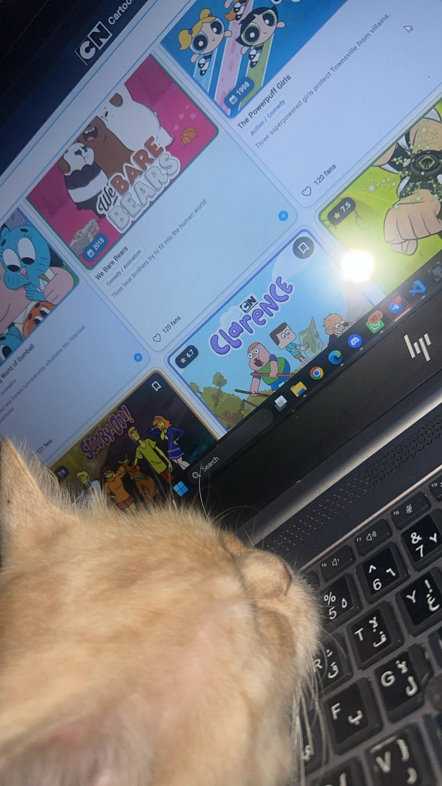

# Cartoon Network — Cartoon Library

A Flutter application for browsing a collection of cartoons through a simple, interactive interface.

## Screenshots

### Main Screen


### Grid View


## Features

- Browse cartoons and view their details.
- Search by title or genre.
- Switch between grid and list views.
- Add and remove favorites.
- View ratings and release years.

## Technologies

- Flutter
- Dart
- Material Design

## Learning Resources

- [Flutter Documentation](https://docs.flutter.dev/)
- [Flutter Codelab](https://docs.flutter.dev/get-started/codelab)
- [Flutter Widgets](https://docs.flutter.dev/ui/widgets)
- [Flutter Layouts](https://docs.flutter.dev/ui/layout)
- [Dart Documentation](https://dart.dev/guides)

## Getting Started

Make sure Flutter is installed, then run:

```bash
git clone https://github.com/shahdelhendawy/movie_library.git
cd movie_library
flutter pub get
flutter run
```

To run the application in Chrome:

```bash
flutter run -d chrome
```

## Project Structure

```text
movie_library/
├── assets/
│   ├── brand/
│   └── posters/
├── screenshots/
│   ├── Cartoon Library.png
│   └── cartoon-grid.png
├── lib/
│   ├── main.dart
│   ├── home_page.dart
│   ├── movie.dart
│   └── movie_card.dart
├── pubspec.yaml
└── README.md
```

## Notes

- Ratings and fan counts are sample values.
- Favorites are not saved permanently between sessions.
- This is an educational project and is not an official Cartoon Network application.

## Author

**Shahd Alhindawy** · [GitHub](https://github.com/shahdelhendawy)